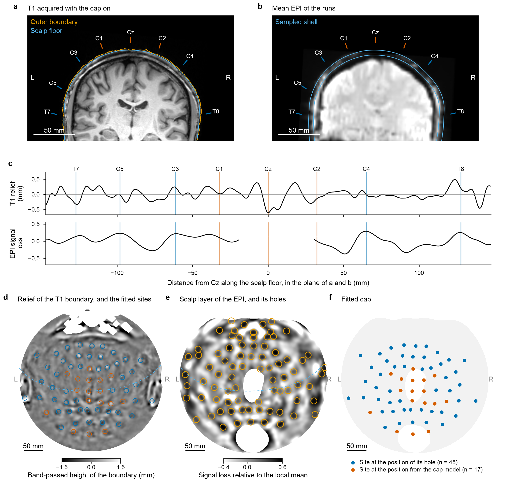
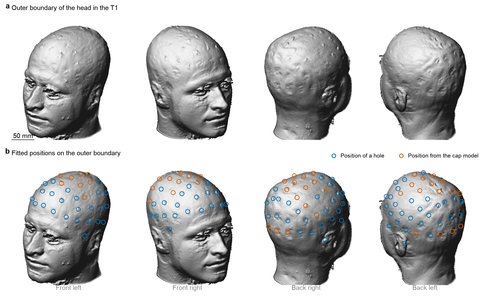
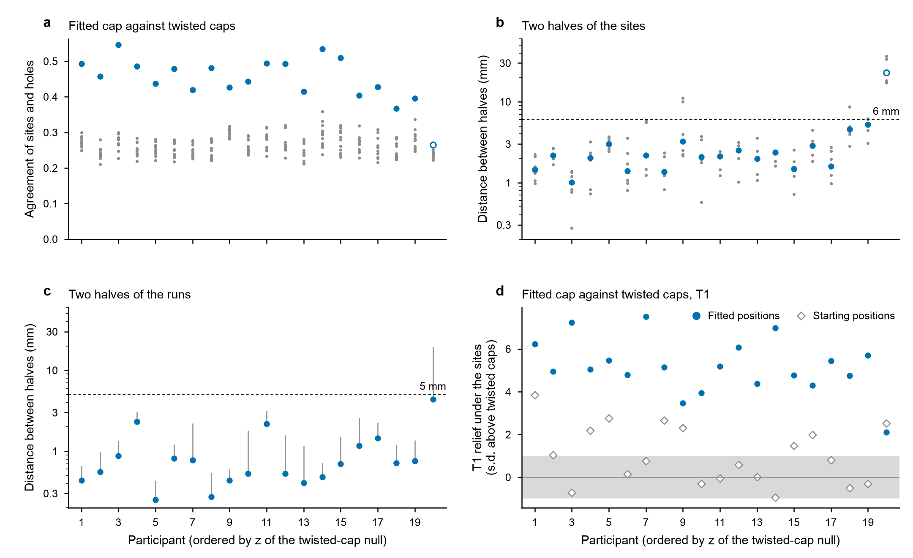
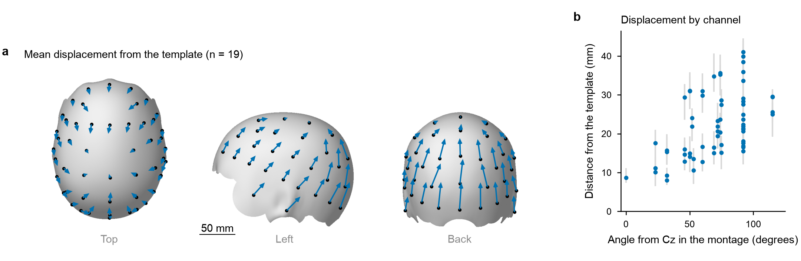
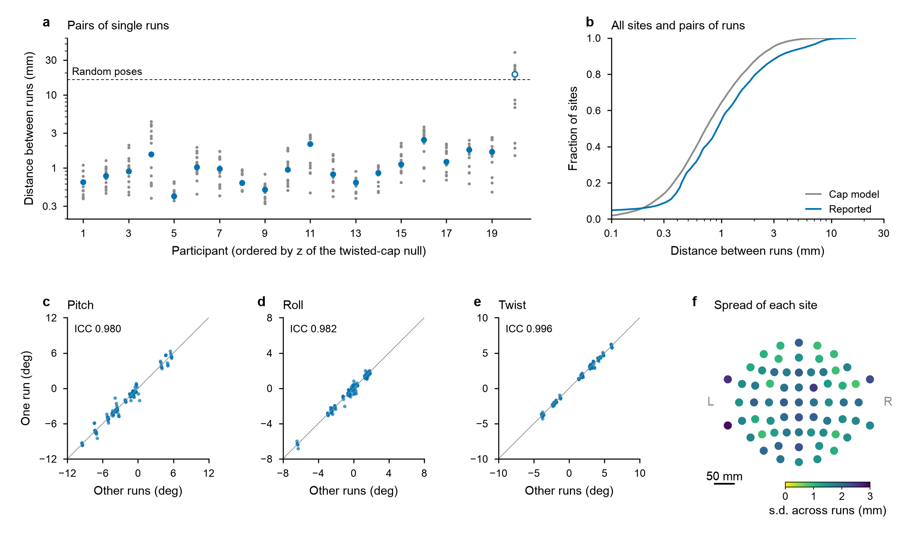
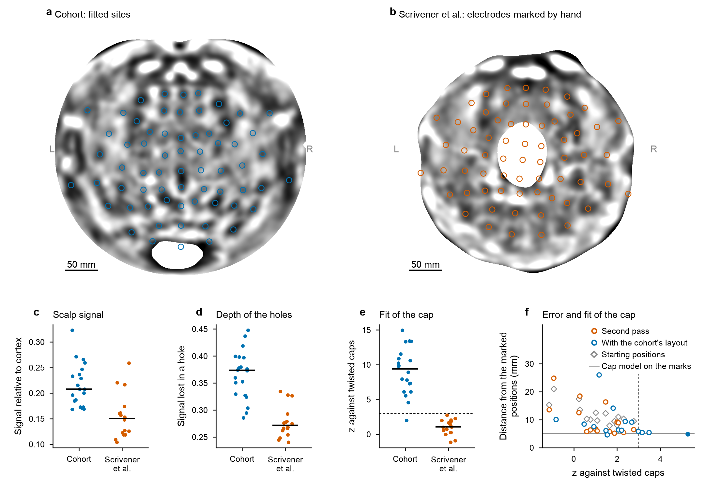

# eegloc

Localization of EEG electrodes in simultaneous EEG-fMRI from the anatomical and functional images
of the recording session.

## Summary

In simultaneous EEG-fMRI, each electrode of the cap produces a signal void of about 15 mm
(hereafter, a hole) in the scalp layer of the echo-planar images (EPI). `eegloc` detects these
holes, fits a model of the whole cap to them over the participant's scalp, and reports the
position of every site in the coordinates of the T1-weighted image, with five checks of each fit.
The inputs are the T1-weighted image acquired with the cap on, one EPI reference image per run
with its transform to the T1, and approximate starting positions of the channels. In 20
participants recorded with a cap of 65 sites, 19 fits met all five criteria; the positions
obtained from two halves of the sites differed by a median 2.1 mm and those obtained from two
halves of the runs by 0.7 mm. The same fit to the electrodes visible in the T1-weighted image
placed the sites a median 2.7 mm from the fit to the EPI. The fitted positions lay a median
21.4 mm along the scalp from the positions of a standard montage fitted to the scalp. The
positions have not been compared with digitized positions.

## Background

In simultaneous EEG-fMRI, electrode positions have been obtained from MR images of the session.
De Munck et al. (2012) flattened the scalp surface of the structural image into a "pancake view"
in which the gel artifacts of the electrodes are selected by hand, and labelled them by fitting a
template grid of the cap. Bhutada et al. (2020) detected the electrodes as protrusions of the
scalp surface in the T1-weighted image and labelled them by comparing their mutual distances with
those of labelled templates. Other methods acquire a dedicated ultra-short echo-time sequence in
which the electrodes are visible: Fleury et al. (2019) detected them with a Hough transform and
Pinte et al. (2021) with a neural network, both registering a template of the cap to the
detections, and reported mean position errors of 3.1 and 2.2 mm against manually selected
positions. Separately, EEG electrodes are known to reduce the signal of EPI near the scalp
(Bonmassar et al., 2001).

`eegloc` differs in three respects. It detects the electrodes in the EPI of the functional runs,
without a dedicated sequence, and uses the T1-weighted image for the shape of the scalp and as an
independent check. It fits all sites at once with a model of the cap laid over the scalp, without
manual selection, so that a site without a detectable hole still receives a position. It reports
checks of the fit for each participant.



**Figure 1 | Electrodes in the T1-weighted image and in the EPI of one participant.**
**a**, T1-weighted image acquired with the cap on, in the plane through the centre of the head,
the fitted position of Cz and the left-right bearing of the cap, with the traced outer boundary of
the head and its lower envelope, the scalp floor. **b**, Mean over six runs of the EPI reference
images in the same plane, with the limits of the shell that is sampled (6 mm below the scalp floor
to the floor); the grey scale ends at 0.85 of the 99th percentile of the image, which saturates
the brain. In **a** and **b**, ticks mark the sites of the cap within 5 mm of the plane, in
blue where the site was assigned the position of a hole and in orange where its position comes
from the cap model. **c**, Height of the outer boundary above the scalp floor, band-passed to
features of 2 to 6 mm (top), and signal loss of the EPI scalp layer relative to its local mean
(bottom), along the scalp in that plane; dashed line, least depth of a hole (0.12). **d**, The
same band-passed height, unfolded by an azimuthal equidistant projection about the centre of the
head and shown within the region a cap can cover, with the fitted sites (circles, coloured as in
**a**). The fit uses this image only for the shape of the scalp. **e**, Signal loss of the EPI
scalp layer in the same projection, within the EPI's coverage of the scalp; circles, detected
holes (n = 78). Dashed line in **d** and **e**, plane of **a** and **b**. **f**, Fitted cap of
65 sites: 48 sites were assigned the position of a hole and 17 keep the position given by the cap
model. The 30 holes of **e** assigned to no site are not shown; 23 of them lie outside the outline
of the fitted cap. In **d**-**f** the front of the head is at the top; scale bars are along a
meridian of a sphere of 90 mm radius. The EPI does not cover the scalp at the vertex of this
participant (gap in **c** and **e**). Positions are those of the second pass.



**Figure 2 | Fitted positions on the head.** **a**, Outer boundary of the head in the
T1-weighted image of the participant of Fig. 1, at the level used by the method (7% of the
intensity of scalp fat), seen from four directions 25 degrees above the horizontal. The gel and
the holders of the electrodes stand out from the scalp. Each ray of the orthographic projection
stops at the first sample above the level; signal detached from the head is left out, and the
depth is smoothed for display (Gaussian, 1 mm) and shaded by a single light. Irregularities
around the eyes are image artefacts at this level. **b**, The same views with the fitted
positions of the sites that face the viewer.

## Method

1. **Scalp.** In the T1-weighted image, the head's outer boundary is traced along rays from a
   centre in the head, as the outermost sample above 7% of the intensity of scalp fat (after
   Bhutada et al., 2020), and unfolded into a flat map by an azimuthal equidistant projection
   (compare the pancake view of de Munck et al., 2012). A smooth lower envelope of this boundary,
   the scalp floor, is taken as the surface on which the cap lies.
2. **Holes.** Each run's EPI reference image is sampled in a shell from 6 mm below the scalp floor
   to the floor itself, through the run's transform to the T1, and averaged over runs. The layer
   is divided by its local mean; holes are the local minima of this ratio.
3. **Cap fit.** The cap is modelled as a fabric: each site lies at a fixed arc length from Cz
   along a fixed bearing, both taken from a standard montage. Sites are laid out over the scalp
   floor accordingly. Five parameters place the cap: the position of Cz (pitch and roll relative
   to the starting positions), the twist of the cap, and its stretch along the left-right and
   front-back directions. They are estimated by differential evolution, maximizing the agreement
   between sites and holes counted in both directions (sites with a hole nearby, holes with a
   site nearby).
4. **Positions.** A site is assigned the position of a hole when that hole lies within 8 mm, is
   nearer to this site than to any other, and the site is within the EPI's coverage of the scalp.
   Other sites keep the position given by the fitted cap model.
5. **Checks.** See [Checks](#checks).

The procedure has two passes. The first pass (`eegloc fit`) treats each participant independently
and uses the layout of the standard montage. The second pass (`eegloc refine`) estimates the
layout of the cap as worn from the participants whose first-pass fit met the criteria: for each
site, the median offset between the fitted site and its hole, expressed in the cap's coordinates
relative to the participant's fitted stretch and made left-right symmetric, is added to the montage's layout where at least five participants
contribute. Each participant is then refitted with the layout estimated from the other
participants, within narrower bounds and from two random seeds.

## Evaluation

### Cohort

The procedure was applied to 20 participants, each recorded with a cap of the same model in the
size of their head: 65 sites (63 channels, reference FCz, ground AFz; layout `easycap-M1`). The
T1-weighted images had a resolution of 1 mm, and there were six EPI runs of 3 mm resolution per
participant. The starting positions were template positions: those of
the standard montage fitted to each participant's scalp surface (the procedure of
`examples/starting_positions.py`).

In the scalp layer, the holes assigned to a site had a median full width at half depth of
14.9 mm (interquartile range 12.5 to 17.0 mm; n = 819 holes in the 19 participants whose fit met
all criteria).



**Figure 3 | Checks of the second-pass fit in every participant (n = 20).** Participants are
ordered by the z value of the twisted-cap null. Filled markers, criterion met; open markers,
criterion not met. **a**, Agreement between sites and holes for the fitted cap (blue) and for 12
fits whose twist is constrained to ranges where the cap cannot be (grey). **b**, Median distance
between the sites as placed by fits to two disjoint random halves of the sites: six splits (grey)
and their median (blue). **c**, Distance between the sites as placed by fits to the holes of runs
1-3 and of runs 4-6: median over sites (blue) and maximum (end of the line). **d**, Mean amplitude
of the band-passed height of the T1 outer boundary under the fitted positions (blue) and under
the starting positions (diamonds), in standard deviations above its mean under 1,000 randomly
twisted placements of the fitted cap; band, one standard deviation either side of that mean.
Dashed lines, criteria.

Nineteen of 20 second-pass fits met all five criteria (Fig. 3). The median over participants of
the split-half distance was 2.1 mm and that of the test-retest distance 0.7 mm. A median 43 of
the 65 sites were assigned the position of a hole; the sites that rarely were (mostly occipital
and fronto-central), the layout learned by the second pass and the comparison of the two passes
are in [Supplementary Fig. 1](docs/supplementary.md).

### Distance from the template positions

In the 19 participants whose fit met all criteria, the fitted position of a channel lay a median
21.4 mm along the scalp from its template position projected onto the scalp floor (range of the
participants' medians, 12.8 to 25.0 mm). The median distance per channel ranged from 8.0 to
41.0 mm and increased with the channel's angle from Cz (Fig. 4). Under the template positions,
the relief of the T1 boundary was a median 0.8 s.d. above its mean under randomly twisted
placements (range -1.0 to 3.8, n = 20); under the fitted positions it was 5.1 s.d. above
(range 2.1 to 7.5; Fig. 3d).



**Figure 4 | Distance of the fitted positions from the template positions.** **a**, Mean over 19
participants of each channel's template position projected onto the scalp floor (dots) and of its
fitted position (arrowheads), in the axes of the T1-weighted images about the centre of the head,
over the mean scalp floor of the same participants. **b**, Distance between the two positions of
each channel against the channel's angle from Cz in the standard montage: median over
participants (blue) and interquartile range (grey).

### Agreement of the two images

The T1-weighted image also shows the electrodes, as bumps of gel and dents of the holders in the
outer boundary (Fig. 2a). In the 19 participants whose fit met all criteria, candidates were
taken in the T1 as the extrema of the band-passed height of the boundary above 0.45 mm, one per
window of 10 mm, within the region a cap can cover (`docs/t1_comparison.py`).

| Median (range) over participants | T1 candidates | EPI holes |
|---|---|---|
| Candidates | 139 (102 to 205) | 80 (75 to 87) |
| Fitted sites with a candidate of their own | 36 (26 to 56) | 44 (32 to 52) |
| The same for the sites twisted about Cz | 20.4 (13.6 to 31.2) | 16.9 (14.6 to 20.8) |
| z of the cap fit against twisted caps | 6.1 (2.7 to 11.6) | 9.8 (4.6 to 15.0) |

The fitted sites of the second and third rows are those of the fit to the EPI holes, which
favours the EPI in the second row.

The second-pass fit was then repeated with the T1 candidates in place of the EPI holes. It
reached z > 3 in 18 of the 19 participants and placed the sites a median 2.7 mm from those of the
fit to the EPI holes (range of the participants' medians, 1.1 to 4.9 mm). Poses drawn at random
within the bounds that both fits search lay a median 16.0 mm from it (13.8 to 18.5 mm). The two
fits share the starting positions, the bounds and the cap layout, which was learned from fits to
the EPI holes of the other participants; they do not share the image in which the electrodes are
detected.

### Repeatability across runs

The test-retest check compares two halves of the runs, and compares the sites as the cap model
places them. The second-pass fit was therefore repeated on the holes of each of the six runs
alone (`docs/run_retest.py`), and the positions as reported (a hole's position where the site has
one) were compared as well. The runs share the T1-weighted image, the starting positions, the
bounds and the cap layout, which was learned from the other participants; each run has its own
EPI reference image and its own transform to the T1.

| Median (range) over the 19 participants whose fit met all criteria | |
|---|---|
| Distance between two runs, sites as placed by the cap model | 0.78 mm (0.34 to 2.38) |
| Distance between two runs, reported positions | 0.96 mm (0.41 to 2.44) |
| Distance between one run and all six runs, reported positions | 0.58 mm (0.31 to 1.66) |
| Holes of two runs that are the same hole | 0.92 (0.86 to 0.96) |
| Distance between the two detections of the same hole | 0.96 mm (0.47 to 1.68) |
| Distance of random poses from the fit to all runs | 16.0 mm (13.7 to 18.6) |

A distance between two runs is the median over sites, then over the 15 pairs of runs of a
participant. Two holes are the same hole when each is the other's nearest within 8 mm, whatever
the cap. Random poses are drawn within the bounds of the search.

Over all sites, pairs of runs and participants, 88% of the reported positions lay within 3 mm of
those of the other run and 94% within 5 mm (Fig. 5b). A site that had a hole in every run (58% of
the sites) had a standard deviation across runs of a median 0.8 mm, and a site that had a hole in
none (25%) of 0.7 mm; a site that had a hole in some runs only (17%), and so alternated between
the position of a hole and that of the cap model, of 3.1 mm. The intraclass correlation of single
runs, ICC(1,1), was 0.980 for the pitch, 0.982 for the roll and 0.996 for the twist of the cap
(Fig. 5c-e), 0.974 and 0.967 for its two stretches, and a median 0.97 across channels (range 0.91
to 0.99) for the displacement of a channel's reported position from its starting position.

The reported positions of consecutive runs differed by a median 0.8 mm and those of runs
separated by at least two others by 1.3 mm, more than consecutive runs in all 19 participants. A
slow displacement of the cap on the head, or a drift of the EPI, would produce this; an error of
measurement alone would not. In the participant whose fit did not meet the criteria, the reported
positions of two runs differed by a median 19.2 mm, as much as random poses (Fig. 5a).

The cap is not taken off between the runs. These distances measure how well the positions repeat,
not how close they are to the electrodes: an error common to the runs (of the scalp floor, of the
cap model, or of the EPI where its distortion is not fully corrected) leaves them unchanged.



**Figure 5 | Repeatability of the positions across single runs.** The second-pass fit repeated on
the holes of each of the six runs alone. **a**, Median over sites of the distance between the
reported positions of two runs: the 15 pairs of runs of each participant (grey) and their median
(blue; open marker, fit that did not meet the criteria). Participants are ordered as in Fig. 3.
Dashed line, median distance of poses drawn at random within the bounds of the search from the
fit to all runs. **b**, Cumulative distribution of the distance between two runs over sites,
pairs of runs and the 19 participants whose fit met all criteria (n = 18,525), for the sites as
placed by the cap model (grey) and as reported (blue); distances below 0.1 mm are at the left
edge. **c**-**e**, Pitch, roll and twist of the cap fitted to one run against their mean over
the participant's five other runs (19 participants, six runs each). Line, identity; the axes span
the bounds of the search. **f**, Standard deviation across runs of each site's reported position,
the three axes combined (root mean square over the 19 participants), on the layout of the standard
montage (nose at the top; scale bar on the unstretched cap).

### A cohort with a weaker EPI and electrodes marked by hand

Scrivener et al. (2021) shared a simultaneous EEG-fMRI experiment recorded with a cap of the same
layout as the cohort's, and Scrivener and Reader (2022) marked each of its 65 electrodes by hand
on the gel artifacts of the structural images, in the scanner coordinates of the image.
`docs/scrivener_data.py` prepares these data as a study: the defaced T1-weighted image, one
reference image for each of the five blocks of the EPI with its rigid registration to the T1, and
starting positions from a template head. Sixteen participants have images, 15 of them marked
positions. Both passes were run with the settings unchanged.

The EPI of this experiment shows less of the scalp and of the electrodes than the cohort's
(`docs/epi_quality.py`; Fig. 6a-d). Its echo time is 30 ms against 20 ms, its voxels are
3 x 3 x 3.6 mm against 3 mm, its 30 slices leave out the vertex, and its distortion was not
corrected here.

| Median (range) over participants | Cohort (n = 20) | Scrivener et al. (n = 16) |
|---|---|---|
| Scalp signal relative to cortex | 0.21 (0.17 to 0.32) | 0.15 (0.10 to 0.26) |
| Depth of the holes | 0.37 (0.29 to 0.45) | 0.27 (0.24 to 0.34) |
| Holes | 80.5 (75 to 94) | 60 (38 to 83) |
| Fitted sites within the EPI's coverage | 0.98 (0.89 to 1.00) | 0.88 (0.69 to 0.94) |
| z of the second-pass fit against twisted caps | 9.4 (2.0 to 15.0) | 1.0 (-1.1 to 2.8) |

The scalp signal is the median of the scalp layer within the EPI's coverage, relative to the same
shell 15 to 25 mm below the scalp floor; the depth of a hole is the signal it loses relative to
the local mean.

No fit met the criteria in either pass (Fig. 6e), and no first-pass fit could teach the layout:
the second pass differed from the first by its bounds and seeds only. With no cap at all, 38% of
the marked electrodes within the EPI's coverage had a hole within 5 mm (range over participants,
24 to 60%), against 9% (6 to 14%) for the same electrodes turned about the vertical axis. This
fraction increased with the depth of the participant's holes (Spearman's rho = 0.66, n = 15).

The positions reported by the second pass lay a median 6.6 mm along the scalp from the marked
positions (range of the participants' medians, 5.2 to 24.9 mm), and the starting positions
10.4 mm (7.9 to 21.0 mm); positions were compared once moved along their ray from the centre of
the head onto the scalp floor. The distance decreased as the z of the fit increased (rho = -0.53;
first pass, -0.65; Fig. 6f). When the second pass was given the layout learned on the cohort in
place of the montage's, three fits reached z > 3, at 4.9 to 5.5 mm from the marked positions, and
one of them met all criteria (4.9 mm).

The cap model was also fitted to the marked positions themselves (`docs/manual_comparison.py`).
Its five parameters left the 65 sites a median 5.1 mm from them with the montage's layout (range
over participants, 4.1 to 7.3 mm) and 4.7 mm with the layout learned on the cohort (3.9 to
7.8 mm). With the montage's layout the sites left farthest were those nearest the ears (median
over participants: TP10, 18.1 mm; FT9, 12.9 mm; TP8, 11.9 mm; TP9, 11.1 mm). A site that keeps
the position of the cap model cannot be expected nearer its electrode than this.

In this experiment the checks rejected every fit, and the rejected fits were 5 to 25 mm from the
electrodes. The experiment does not give the accuracy of a fit that meets the criteria, nor that
of a site assigned the position of a hole in an EPI such as the cohort's.



**Figure 6 | An EPI that shows little of the electrodes.** **a**, Signal loss of the EPI scalp
layer in the participant of the cohort whose holes have the median depth, with the positions of
the second pass (circles). **b**, The same in the participant of Scrivener et al. whose holes
have the median depth, with the electrodes marked by hand on the T1, moved onto the scalp floor
(circles). Grey scale and projection of Fig. 1e; the EPI of **b** does not cover the vertex.
**c**-**e**, Signal of the scalp layer relative to the cortex (**c**), median depth of the holes
(**d**) and z of the second-pass fit against twisted caps (**e**; dashed line, criterion) in each
participant of the cohort (blue, n = 20) and of Scrivener et al. (orange, n = 16); bars, medians.
**f**, Median distance along the scalp between the reported and the marked positions against the
z of the fit, in the 15 participants with marked positions: second pass (orange), second pass
with the layout learned on the cohort (blue; filled marker, all criteria met), and starting
positions (diamonds, at the z of the second pass). Grey line, median distance left by the cap
model fitted to the marked positions; dashed line, criterion.

### Synthetic head

On a synthetic participant whose 65 electrodes are placed by the cap model at a known pose
(`examples/synthetic_participant.py`), both passes recover the positions with a median error of
0.83 mm (maximum 1.31 mm; [Supplementary Fig. 2](docs/supplementary.md)). This tests the chain
from images to positions; it does not test the cap model, which generated the positions.

## Installation

```bash
pip install git+https://github.com/JoshuaDuq/eegloc.git
```

Python 3.11 or later is required.

## Inputs

For each participant:

| Input | Description |
|---|---|
| T1 | T1-weighted image acquired with the cap on, in the same session as the EPI. |
| EPI reference images | One 3D reference image per run, for at least two runs (for example fMRIPrep's `desc-coreg_boldref.nii.gz`). |
| Transforms | The EPI-to-T1 image transform of each run, as an ITK affine text file (for example fMRIPrep's `from-boldref_to-T1w_mode-image_desc-coreg_xfm.txt`). |
| Starting positions | Tab-separated file with columns `name`, `x`, `y`, `z`: approximate positions of the recorded channels in the scanner coordinates of the T1 (mm). |

The starting positions define the channel names and the origin of the search. Only Cz, C3 and C4
are used for the latter; the first pass searches within 20 degrees of pitch, 12 degrees of roll
and 15 degrees of twist of the frame they define. A template placement is sufficient.
`examples/starting_positions.py` produces one with MNE-Python, by fitting a standard montage to
the scalp surface of a FreeSurfer reconstruction (fiducials estimated from fsaverage, followed by
iterative closest point).

Site names follow one of the
[standard montages of MNE-Python](https://mne.tools/stable/auto_tutorials/intro/40_sensor_locations.html),
which must contain Cz, C3 and C4.

## Usage

A cohort is described in a study file:

```toml
# study.toml
output = "/data/derivatives/eegloc"
subjects = ["sub-01", "sub-02", "sub-03"]
montage = "easycap-M1"   # standard montage of MNE-Python that the cap follows
reference = "FCz"        # sites of the cap that record no channel of their own (optional)
ground = "AFz"

[inputs]                 # {subject} is substituted; * matches the runs, taken in sorted order
t1 = "/data/bids/{subject}/anat/{subject}_T1w.nii.gz"
epi = "/data/derivatives/fmriprep/{subject}/func/{subject}_task-rest_run-*_desc-coreg_boldref.nii.gz"
transform = "/data/derivatives/fmriprep/{subject}/func/{subject}_task-rest_run-*_from-boldref_to-T1w_mode-image_desc-coreg_xfm.txt"
start = "/data/derivatives/template/{subject}_electrodes.tsv"
```

First pass:

```bash
eegloc fit study.toml --jobs 4
```

Second pass:

```bash
eegloc refine study.toml --jobs 4
```

`--jobs` sets the number of participants fitted in parallel. `--subjects` restricts the first pass
to some participants of the study. The second pass requires the first-pass outputs of every
participant of the study.

The synthetic participant can be generated and processed without data:

```bash
python examples/synthetic_participant.py synthetic
```

```bash
eegloc fit synthetic/study.toml
```

```bash
eegloc refine synthetic/study.toml
```

## Outputs

```
<output>/
  maps/<subject>.npz                              scalp maps and holes (read by the second pass)
  first/                                          first pass
    <subject>_space-ScanRAS_electrodes.tsv        positions
    <subject>.json                                fitted parameters and checks
    <subject>.png                                 holes and fitted cap on the scalp map
    summary.tsv                                   one row per participant
  second/                                         second pass, same files
```

Columns of `*_electrodes.tsv`:

| Column | Description |
|---|---|
| `name` | Site name. |
| `x`, `y`, `z` | Position in the scanner coordinates of the T1 (right, anterior, superior; mm). |
| `source` | `hole`: position of the site's hole in the EPI. `cap model`: position given by the fitted cap. |
| `role` | `channel`, `reference` or `ground`. |

## Checks

| Check | Quantity | Criterion |
|---|---|---|
| Twisted-cap null | Score of the fit relative to the scores of 12 fits whose twist is constrained to ranges of 20 degrees centred from 40 to 140 and from 220 to 320 degrees, as a z value. | z > 3 |
| Split halves | Median distance between the sites as placed by fits to two disjoint random halves of the sites (median over six splits). | < 6 mm |
| Test-retest | Median distance between the sites as placed by fits to the holes of the first and of the second half of the runs. | < 5 mm |
| Independent image | Mean amplitude of the T1's band-passed boundary height (gel bumps, holder dents) under the fitted sites, relative to 1,000 randomly twisted placements. | p < 0.05 |
| Bounds | Distance of each fitted parameter from the limits of its search range. | none at a limit |

A fit is recorded as `passed` when all five criteria are met.

## Limitations

- The scalp surface is taken from a T1-weighted image acquired with the cap on.
- Sites outside the EPI's coverage of the scalp, or without a distinct hole, receive the position
  given by the cap model.
- The second pass assumes that all participants wore caps of the same layout. Their size may
  differ: each participant's stretch is fitted, and the layout is learned relative to it.
- No fit that meets the criteria has been compared with measured positions: in the one
  experiment with electrodes marked by hand, no fit met them. On the cohort of the evaluation, the
  support of the positions is the five checks, the agreement of the fits to the two images and
  their repeatability across runs, which measures precision and not accuracy.
- The EPI must show the scalp and the electrodes. Where it showed less of them (an echo time of
  30 ms, thicker slices, the vertex out of the field of view), no fit met the criteria;
  `docs/epi_quality.py` reports the scalp signal and the depth of the holes of a study.
- The cap model, fitted to electrodes marked by hand, was a median 5 mm from them, and 11 to
  18 mm at TP9, TP10, FT9 and TP8. A site without a hole of its own cannot be expected nearer.
- The settings (`src/eegloc/config.py`) were chosen on the cohort described above, which is also
  the cohort of the evaluation: no participant was held out.

## Tests and figures

```bash
pip install -e ".[dev]"
```

```bash
pytest
```

```bash
pytest -m slow
```

The slow test runs both passes from the command line on the synthetic participant.
`docs/t1_comparison.py` compares the electrodes seen in the two images and `docs/run_retest.py`
repeats the fit on each run alone. `docs/make_figures.py` draws the figures of this page and of
[the supplementary page](docs/supplementary.md) from the outputs of a study, for one of its
participants, of `docs/run_retest.py` and of the synthetic participant.

`docs/scrivener_data.py` fetches and prepares the experiment of Scrivener et al. as a study (it
needs `antspyx`); once both passes have been run on it, `docs/epi_quality.py` measures what the
EPI of a study shows, and `docs/manual_comparison.py` compares the fits with the marked positions
and draws Fig. 6.

## References

Bhutada, A. S., Sepúlveda, P., Torres, R., Ossandón, T., Ruiz, S. & Sitaram, R. Semi-automated and
direct localization and labeling of EEG electrodes using MR structural images for simultaneous
fMRI-EEG. *Front. Neurosci.* **14**, 558981 (2020).

Bonmassar, G., Hadjikhani, N., Ives, J. R., Hinton, D. & Belliveau, J. W. Influence of EEG
electrodes on the BOLD fMRI signal. *Hum. Brain Mapp.* **14**, 108-115 (2001).

de Munck, J. C., van Houdt, P. J., Verdaasdonk, R. M. & Ossenblok, P. P. W. A semi-automatic
method to determine electrode positions and labels from gel artifacts in EEG/fMRI-studies.
*NeuroImage* **59**, 399-403 (2012).

Fleury, M., Barillot, C., Mano, M., Bannier, E. & Maurel, P. Automated electrodes detection during
simultaneous EEG/fMRI. *Front. ICT* **5**, 31 (2019).

Pinte, C., Fleury, M. & Maurel, P. Deep learning-based localization of EEG electrodes within MRI
acquisitions. *Front. Neurol.* **12**, 644278 (2021).

Scrivener, C. L., Malik, A., Lindner, M. & Roesch, E. B. Sensing and seeing associated with
overlapping occipitoparietal activation in simultaneous EEG-fMRI. *Neurosci. Conscious.* **2021**,
niab008 (2021).

Scrivener, C. L. & Reader, A. T. Variability of EEG electrode positions and their underlying
brain regions: visualizing gel artifacts from a simultaneous EEG-fMRI dataset. *Brain Behav.*
**12**, e2476 (2022).

## License

MIT
