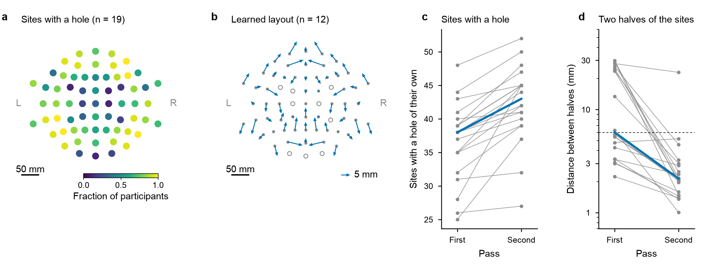
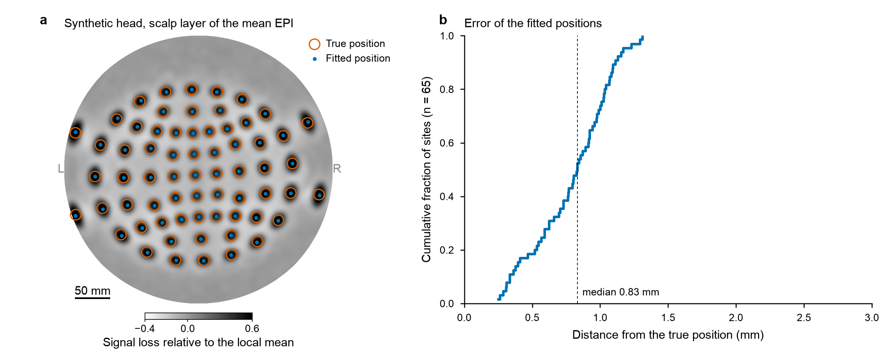

# Supplementary figures

## The two passes and the sites with a hole

**Supplementary Figure 1 | Sites with a hole, learned layout, and the two passes.** **a**,
Fraction of the 19 participants whose fit met all criteria in which each site was assigned the
position of a hole, on the layout of the standard montage (nose at the top). **b**, Layout learned
from the 12 participants whose first-pass fit was sound: displacement of each site from its
position in the standard montage (arrows magnified five times; open circles, sites with fewer than
five contributing participants, left uncorrected). **c**, **d**, Number of sites assigned the
position of a hole (**c**) and median split-half distance (**d**) in each participant in the
first and in the second pass (grey, n = 20) and their medians (blue). Dashed line, criterion. In
**a** and **b**, scale bars are on the unstretched cap.

Nine of 20 first-pass fits and 19 of 20 second-pass fits met all five criteria. Between the first
and the second pass, the median number of sites assigned the position of a hole rose from 38 to
43, the median z value of the twisted-cap null from 4.1 to 9.4, and the median split-half
distance fell from 6.0 to 2.1 mm.

The fraction of participants in which a site was assigned the position of a hole ranged from
0.11 to 1.00 across sites: it was at least 0.8 for 28 of the 65 sites and below 0.3 for 10 (O1,
Oz, O2, FC1, FC2, FC3, FC4, C1, C2 and CP4).

## Synthetic head

**Supplementary Figure 2 | Fitted and true positions on a synthetic head.** **a**, Signal loss of
the EPI scalp layer, with the true (orange) and fitted (blue) positions of the 65 sites. **b**,
Cumulative distribution of the distance between fitted and true positions; dashed line, median.

`examples/synthetic_participant.py` writes a synthetic participant: an ellipsoidal head with
scalp fat and a gel blob at each electrode in the T1-weighted image, and four EPI runs of 3 mm
resolution, each displaced by 1.2 to 1.5 mm, with a void of 7.5 mm radius at each electrode. The
65 electrodes are placed by the cap model at a known pose. Both passes recover their positions
with a median error of 0.83 mm (maximum 1.31 mm). This tests the chain from images to positions;
it does not test the cap model, which generated the positions.
